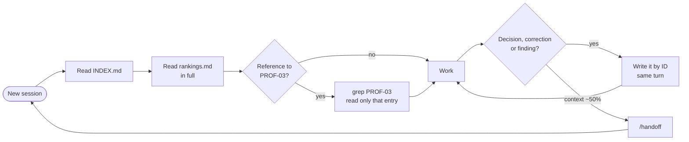

<p align="center">
  
</p>

<h1 align="center">Vincent's /compact Killer</h1>

<p align="center">
  <b>Say it once. Your coding agent remembers, feature by feature.</b><br>
  Per-feature memory files and a <code>/handoff</code> skill for Claude Code that keep decisions,
  corrections and project state across sessions. Plain markdown, nothing to run.
</p>

<p align="center">
  <a href="#-quick-start"></a>
  <a href="https://docs.claude.com/en/docs/claude-code/overview"></a>
  
  <a href="LICENSE"></a>
</p>

<p align="center">
  <a href="#-the-problem">Problem</a> ·
  <a href="#-compact-vs-compact-killer">Comparison</a> ·
  <a href="#-how-it-works">How it works</a> ·
  <a href="#-quick-start">Quick start</a> ·
  <a href="#-why-it-costs-less">Cost</a> ·
  <a href="#-faq">FAQ</a>
</p>

<br>

## 🩹 The problem

Long feature work spans many sessions, and every new session starts blank. `/compact`
keeps the *topic* and drops the *verdict*, so you end up saying the same things again:

> *"No, we already decided that."*
> *"The name goes in the header. I told you twice."*
> *"Don't rename that field, we found out why last week."*

**/compact Killer** gives each feature a short file the agent reads before it starts and
writes to the moment something is settled. Nothing settled gets lost between sessions.

<br>

## ⚔️ /compact vs /compact Killer

Three moments from a real feature build, and what survives each approach.

<table>
  <thead>
    <tr>
      <th width="16%"></th>
      <th width="28%">🧠 In the context window</th>
      <th width="26%">🗜️ After <code>/compact</code></th>
      <th width="30%">📌 In <code>docs/features/rankings.md</code></th>
    </tr>
  </thead>
  <tbody>
    <tr>
      <td><b>A decision that changed</b></td>
      <td>30 messages: you asked for "last 5 matches", saw it on device, said it looks empty for small groups, switched to season-wide.</td>
      <td><i>"Discussed rankings display, settled on a season view."</i><br>❌ Rejected option and reason gone.</td>
      <td><b>RANK-03 · Season-wide with period tabs.</b> Rejected "last 5": empty for small groups.<br>✅ Never proposed again.</td>
    </tr>
    <tr>
      <td><b>A correction you made</b></td>
      <td>3 screenshots: the name goes under the header title, not in the page body. The agent got it wrong twice.</td>
      <td><i>"Adjusted header layout per user feedback."</i><br>❌ The rule is gone, the mistake comes back.</td>
      <td><b>PROF-02 · Name and photo go in the header subtitle slot.</b> Corrected twice.<br>✅ The rule outlives the session.</td>
    </tr>
    <tr>
      <td><b>A debugging discovery</b></td>
      <td>40 tool calls of logs and queries ending in: the API returns <code>rating_avg</code>, not <code>avgRating</code>.</td>
      <td><i>"Fixed rating display bug."</i><br>❌ A later session "fixes" it back.</td>
      <td><b>RANK-06 · The API sends <code>rating_avg</code>.</b> Mapped in <code>services/rankings.ts</code>.<br>✅ Nobody undoes it.</td>
    </tr>
  </tbody>
</table>

| | `/compact` | Plain handoff note | **/compact Killer** |
|---|:---:|:---:|:---:|
| You control what is kept | ❌ | ✅ | ✅ |
| Survives the session | ❌ | ✅ | ✅ |
| Builds up per feature over weeks | ❌ | ❌ | ✅ |
| Cross-feature links without reading everything | ❌ | ❌ | ✅ |
| Readable by Codex, Cursor, humans | ❌ | ✅ | ✅ |
| Setup | none | none | 4 files |

<br>

## 🧩 How it works



```
docs/features/
├── INDEX.md        one line per feature, read first
├── README.md       the convention
├── _TEMPLATE.md    State · Decisions · Corrections · Gotchas
├── rankings.md
└── profile.md
.claude/skills/handoff/SKILL.md
```

| Principle | Why |
|---|---|
| **Index first, one file per feature** | Files stay at 50 to 150 lines, so reading one in full is cheap. |
| **Stable IDs, never line numbers** | `### RANK-03 · Title`. Line numbers shift on every edit, IDs never do. |
| **Reference by ID, never copy** | `Follows RANK-03.` A rule lives in exactly one place. |
| **Keep the rejected option and the reason** | That is what stops the agent from relitigating. |
| **Write during, not after** | Captured the moment it happens, not reconstructed from a tired context. |
| **Code wins** | If the file and the tree disagree, trust the tree and fix the file. |

<details>
<summary><b>See an example feature file</b></summary>

```md
# Rankings

Prefix: `RANK` · Branch: `feat/rankings-periods` · PR: #42 · Updated: 2026-10-10
Links: profile (PROF-03)

## State
- Done: leaderboard list, period picker, locked state for free plans.
- Doing: player breakdown sheet.
- Next: empty states, translations.

## Decisions
### RANK-03 · Season-wide with period tabs
Rejected: "last 5 matches", because it looked empty for small groups.

## Corrections
### RANK-04 · Locked state is a static wireframe, not a pulsing skeleton
Got wrong: reused the loading skeleton with its animation.

## Gotchas
### RANK-06 · The API sends `rating_avg`, not `avgRating`
Mapped once in `services/rankings.ts`. Don't rename it on the client.
```

Full files: [`rankings.md`](docs/features/rankings.md), [`profile.md`](docs/features/profile.md).

</details>

<br>

## 🚀 Quick start

**1. Get the files.** From your project root:

```bash
git clone --depth 1 https://github.com/vincent-caetano/vincents-compact-Killer /tmp/compact-killer
```

```bash
mkdir -p .claude/skills docs/features && cp -R /tmp/compact-killer/.claude/skills/handoff .claude/skills/ && cp /tmp/compact-killer/docs/features/{README.md,_TEMPLATE.md,INDEX.md} docs/features/
```

**2. Teach your agent.** Paste [`snippets/CLAUDE.md`](snippets/CLAUDE.md) into your
`CLAUDE.md`, and into `AGENTS.md` if you also use Codex.

**3. Restart.** Open a new Claude Code session so the skill loads. Clear the example lines
from `INDEX.md`, and you are set.

### Daily use

| You | The agent |
|---|---|
| *"Work on rankings."* | Reads `INDEX.md` and `rankings.md`, follows IDs into other features. |
| You decide or correct something | Writes it to the file by ID, in the same turn. |
| `/handoff` at ~50% context or end of day | Updates the file, prints the one-line prompt for the next session. |

<br>

## 💸 Why it costs less

- **Every turn resends the whole conversation.** A lean new session is cheaper on every
  message after the switch. The earlier you hand off, the more you save.
- **Hand off at about half the context window.** Auto-compact fires near full, when output
  quality is already at its worst.
- **Mind the prompt cache (about an hour).** Back the same day: `/compact` or just
  continue. Back tomorrow: hand off, because resuming an old session pays for its whole
  history again.
- **Small files beat one big memory.** Whatever is read every session is paid every
  session, which is why this is one file per feature behind an index.

<br>

## ❓ FAQ

<details>
<summary><b>Isn't this what CLAUDE.md is for?</b></summary>
<br>
<code>CLAUDE.md</code> holds rules for the whole project and is loaded every session. Feature
files hold the state and history of one feature and are read only when you work on it.
Putting every feature in <code>CLAUDE.md</code> makes every session pay for all of them.
</details>

<details>
<summary><b>Does it work with Codex or Cursor?</b></summary>
<br>
The memory files are plain markdown, so any agent can read and write them: paste the
snippet into <code>AGENTS.md</code> or your rules file. The <code>/handoff</code> command
itself is a Claude Code skill. Elsewhere, ask the agent to follow
<code>.claude/skills/handoff/SKILL.md</code>.
</details>

<details>
<summary><b>What if a file gets stale?</b></summary>
<br>
The agent checks claims against the tree before acting on them. Code wins, and the file
gets fixed. Superseded entries are rewritten in place under the same ID, so there is never
a second, conflicting version of a rule.
</details>

<details>
<summary><b>Why not Spec Kit, BMAD or a Memory Bank?</b></summary>
<br>
Spec frameworks are great for planning a feature from scratch, but they produce hundreds
of lines per feature. A project-wide Memory Bank is read in full every session and grows
forever. This is the small middle: per-feature, indexed, and only what you would otherwise
have to repeat.
</details>

<br>

## 🙏 Prior art

A lightweight hybrid of ideas the community already uses:
[handoff-skill](https://github.com/simplybychris/handoff-skill) and
[claude-auto-handoff](https://github.com/alexknowshtml/claude-auto-handoff) (handoff files
instead of `/compact`), Cline's [Memory Bank](https://docs.cline.bot/prompting/cline-memory-bank)
(persistent markdown), Anthropic's
[effective harnesses for long-running agents](https://www.anthropic.com/engineering/effective-harnesses-for-long-running-agents)
(progress file plus git log), and Architecture Decision Records (stable IDs per decision).

<br>

<p align="center">
  <br>
  <sub>MIT licensed. If it saved you from repeating yourself, leave a ⭐.</sub>
</p>
